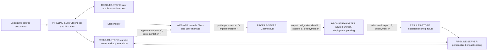

# How the system connects

Evidence labels: **S** = inspected server source in the November 2 snapshot; **O** = owner description on November 3; **P** = pending deployed-resource or code verification. The local web-app/Function source has now also been inspected; see [WEB_APP.md](WEB_APP.md) for its more detailed source-level map. Source inspection proves an implementation/reference exists, not that it is deployed or currently running.

The diagram is a logical data map, not a network/firewall or permission diagram. It does not establish public accessibility of any storage tier. Inspected Python helpers perform backend Cosmos and Blob access. Browser/network behavior and all other access paths remain unverified. The dashed arrows retain deployment-verification gaps even where implementation is now inspected.

## Legislative document flow

The inspected `stages/` modules implement ingestion, chunking, extraction, synthesis and standardization. They use `services/azure_blob_service.py` for storage. Source code distinguishes bronze/raw, silver/intermediate and gold/curated tiers. Embedding and prediction code also exists; inclusion/order in the actual production schedule still needs confirmation.

`build_app_snapshot.py` assembles app-ready snapshot/trail outputs. This is an important boundary: the web app can consume prepared results rather than recreate the server's entire processing workload. Verify the app's actual read paths, cache policy and refresh behavior before claiming an exact integration contract.

## Personalization flow

`score_impact_prompts.py:4-16` describes user prompts being exported from Cosmos by a Function and read from Blob Storage, along with standardized bill features. The server scores prompt/bill combinations using its local model service and writes results to the curated tier. The source explains this bridge as a response to server-to-Cosmos connectivity restrictions; that explanation has not been verified against current network configuration.

The local `digest_function/prompt_exporter/__init__.py` now confirms an implementation of the export bridge. `settings_profile_schema.md:27-53` describes profile records and an exporter path for profile inputs. Its design notes are not proof of the live Cosmos schema or current consent enforcement. No real profile records were inspected or included in this map.

## Deployment boundaries

Changing one component does not automatically update the others. Server code, model serving, blob outputs, web-app code, exporter code, Cosmos schema/settings and secrets all have their own deployment or update paths. The handoff must identify each path, its current version and rollback procedure. GitHub is source/document hosting; pushing here does not deploy the system.

## Access and trust boundaries to verify

- Web sign-in, user-to-profile authorization and per-user filtering of personalized outputs.
- Identity used for each Blob/Cosmos read and write; actual storage permissions and network restrictions.
- Exported profile/prompt content, access, retention and deletion propagation. These exports can remain sensitive even though they are stored beside legislative results.
- Whether any SAS-based path is used, its approved scope, expiry, rotation procedure and responsible owner. Never put a SAS URL in public documentation.
- Whether model endpoints receive personal scoring inputs and where those requests/results are logged.
- Separation between published legislative datasets and user-specific scoring artifacts; do not assume all curated outputs are public.

These are inventory/validation tasks, not statements that the live application currently enforces them.
