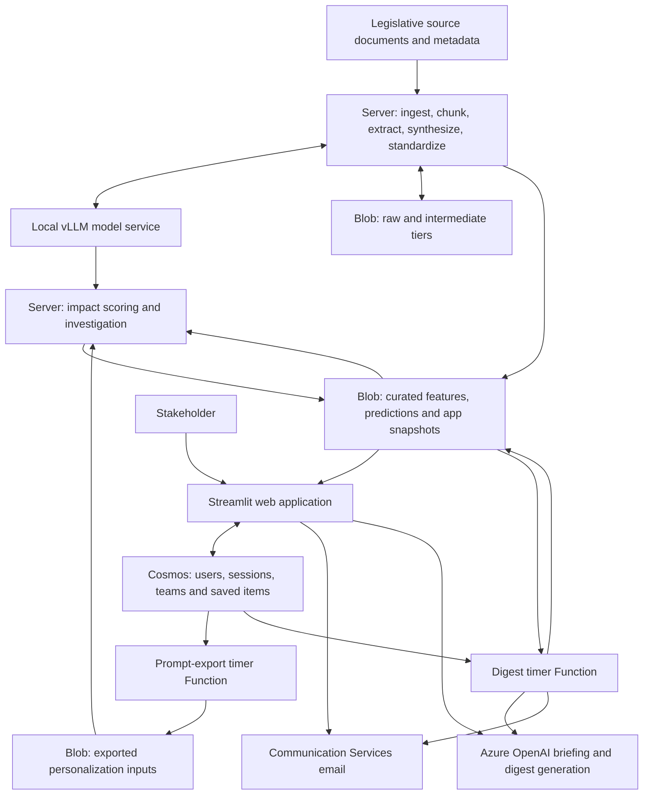

# Legislative Intelligence Platform: system guide

**Purpose.** Convert legislative documents into searchable, filterable, evidence-linked information and personalized stakeholder views. The implementation combines server-side document/model processing, curated data products, a Python web application, profile persistence and scheduled export/email work. This guide describes inspected source and supplied deployment evidence as of November 3, 2026. It is not a report of new live testing.

## 1. Architecture and responsibilities

The diagram describes logical source dependencies. It is not a validated network/access-control diagram. The application performs real work beyond presentation: identity/session handling, Cosmos persistence, filtered data loading, collaboration, AI briefings and email integration. Its deployment is independent of the server and Function deployments.

### What the evidence establishes

| Component | Evidence | Limit |
|---|---|---|
| Web app | Local tracked source at `aab47ea853657e38381ed52230372377e49da240` matches the supplied successful Azure release log; CLI confirms Python 3.11 and Streamlit startup | Site behavior, deployed settings and authorization were not exercised |
| Functions | CLI lists the exporter and digest; portal shows both enabled; active release log confirms Azure CLI ZIP deployment with remote Oryx build | Exact deployed source/package identity and recent invocation success remain unverified |
| Server | Verified snapshot; wrapper and local-import call graph | Actual current scheduler, active writers and server changes since capture are unverified |
| Storage/database | Owner-supplied Azure metadata, source readers/writers | No user documents or blob payloads were read; output metadata reads were denied |
| Supporting Azure resources | Email/AI resource types match source dependencies | Live service identities, permissions and successful external calls remain unverified |

## 2. Server document and model flow

The traced wrapper family is `scripts/run_daily_with_vllm_check.sh` -> `run_legislation_daily.py`, followed by `scripts/run_personalization.sh`. This is a source-level call relationship, not a verified crontab entry. The shell wrapper health-checks the local model service and can start it with `scripts/start_vllm.sh`. Running these files is operationally consequential.

The core orchestrator refers to these stages:

| Stage | Source | Responsibility/output boundary |
|---|---|---|
| Ingestion | `components/pipeline/stages/ingestion.py` | Legislative retrieval, document metadata/manifests, change handling and raw-tier output |
| Chunking | `components/pipeline/stages/chunker.py` | Document-to-chunk preparation and intermediate storage |
| Extraction | `components/pipeline/stages/extractor.py` | Model-based structured features using versioned configuration |
| Synthesis | `components/pipeline/stages/synthesizer.py` | Consolidate extracted information into bill-oriented results |
| Standardization | `components/pipeline/stages/standardizer.py` | Normalize the features/schema used by downstream consumers |
| Embedding | `components/pipeline/stages/embedder.py` | Embedding artifacts for downstream semantic operations |
| Prediction updates | `components/pipeline/run_daily.py`, `stage2_transformers.py` | Source refresh, scoring, integration outputs and validation/history updates |
| Change/history products | `build_diffs.py`, `build_probability_trail.py` | Change information and probability trails |
| App snapshot builder | `build_app_snapshot.py` | App-ready joined snapshot/trail; scheduled invocation remains unverified |

The Blob adapter is `components/pipeline/services/azure_blob_service.py`. Model interaction is separated into `services/vllm_service.py`. The model-service source also contains optional Langfuse telemetry integration. Endpoint and credential references are externalized; whether telemetry is enabled, what is recorded and the approved routing must be verified rather than assumed. Dependencies reached through these modules are retained; model weights, fitted artifacts, downloaded documents and generated tables are intentionally outside Git. Restore them only from approved, versioned locations. A source checkout alone does not recreate the model environment.

Personalization is separated in the inspected wrapper: `score_impact_prompts.py` scores exported user inputs against legislative features; `investigate_flagged_bills_v2.py` provides the subsequent investigation path. The core script contains disabled older personalization blocks. Do not infer an enabled step from comments or reactivate it, as that could duplicate work already called by the wrapper.

## 3. Web application

`components/webapp/app.py` registers Home, My Tracker, Trends, Explorer, Active Bills, Validation and Roadmap. Those registered page files and their local imports form the imported app subset. The existing Network source is not registered by this entry point and is excluded, as are its graph datasets and builders. The Roadmap file is retained because it is a registered application page; retaining it does not implement its planned features.

| Responsibility | Source inside `components/webapp/` |
|---|---|
| Navigation/sign-in coordination | `app.py`, `home.py` |
| Authentication and sessions | `user_auth.py`, `auth_utils.py` |
| Saved items, notes and sharing | `user_profile.py` |
| Teams/membership | `team_service.py` |
| Legislative product locations | `data_catalog.py` |
| Predictions/investigations/impact reads | `predictions_loader.py`, `investigation_loader.py`, `impact_loader.py` |
| Semantic-search support | `semantic_search.py` |
| Briefings and email | `ai_briefing.py`, `email_service.py` |
| Styling/accessibility | `app_theme.py`, `a11y.py`, `chart_a11y.py`, `histogram_filters.py`, bundled word-cloud JavaScript |

The configured startup command is `python -m streamlit run app.py --server.port 8000 --server.address 0.0.0.0`, executed from the web component's deployed root. Azure's web build resolved Python 3.11.18 for the observed release. Captured requirements and transitive dependencies are not a complete independently tested environment lock.

`impact_loader.py` caches the full configured impact Parquet for 1,800 seconds and filters by the requested user ID. Incoming identity, every caller and backing data access still require authorization verification; a local dataframe filter is not proof of complete user isolation. App data locations and signed URLs belong in external configuration, not public Git history.

## 4. Cosmos persistence and user-specific data

Source connects through `user_auth._get_db()` and container helpers. Azure metadata establishes these logical stores:

| Container role/name used by source | Partition key | Observed container TTL |
|---|---|---|
| Sign-in tokens: `magic_tokens` | `/email` | 3,600 seconds |
| Sessions: `user_sessions` | `/user_id` | 691,200 seconds |
| User records: `users` | `/email` | No default TTL reported |
| Saved items/profile inputs: `saved_items` | `/user_id` | No default TTL reported |
| Teams: `teams` | `/pk` | No default TTL reported |
| Digest diagnostics: `digest_diag` | `/run_id` | No default TTL reported |
| Additional results store: `impact_results` | `/user_id` | No default TTL reported; active consumer unresolved |

These are schemas/metadata, not sample user records. TTL values are container defaults; application behavior and per-item overrides may differ. No default TTL is not a documented retention policy. Current app loaders use Blob-backed impact results; the presence of a similarly named Cosmos container does not prove that the app reads it.

## 5. Export, digest and external services

`components/functions/prompt_exporter/__init__.py` queries prompt/profile types from saved items and writes scoring inputs to Blob Storage. Source identifies an intermediate Blob bridge because the server does not directly use Cosmos for this path. Exported prompts/profiles and per-user results are sensitive artifacts even when stored in the same curated tier as legislative data.

`components/functions/digest_timer/__init__.py` gathers user/saved-item state and legislative results, generates digest content through Azure OpenAI, sends email through Azure Communication Services, and writes state used by subsequent runs. It also has diagnostic paths. The two `function.json` files use `PROMPT_EXPORT_CRON` and `DIGEST_CRON`, with monitored timer bindings and no run-on-startup. The reported schedules are daily 01:00 export and Monday 07:00 digest with Chicago timezone on a Linux dedicated App Service plan. Successful and punctual invocations remain unverified.

The Function component intentionally has its own `requirements.txt`, catalog and email helper. Changes must be deployed there separately. A saved local ZIP differs from the current digest/email files, so this release packages the current inspected local Function source as a candidate—not an asserted copy of the active package. The observed Azure deployment ID is a UUID, not an established source commit.

Email identity, Cosmos configuration, model endpoints, Blob identities, signed locations and AI keys must be restored through approved secret/configuration management. `docs/CONFIGURATION_KEYS.json` and component `.env.example` files inventory the extra names introduced by source scrubbing; the runbook lists the established application-setting families.

## 6. Data contracts and ownership

Keep the following boundaries explicit when changing schemas or schedules:

1. Legislative document/manifests -> chunk IDs and extraction inputs.
2. Standardized features -> prediction, personalization and app-snapshot builders.
3. App snapshots/trails -> catalog and dataframe joins in the web app and digest.
4. Cosmos saved items -> exported personalization input schemas.
5. Personalization results -> user-filtered app views and digest generation.
6. State/logs -> restart decisions, diagnostics and alerting.

For each boundary record producer/consumer version, stable identifiers, schema, publication signal, freshness target, user isolation, retention and owner. A file modification timestamp alone cannot verify schema completeness or end-to-end success. Exact resources and owner contacts belong in the restricted deployment register, not the public portfolio.

## 7. Portfolio scope and limitations

This source release demonstrates the architecture and implementation of the system: server AI processing, data products, web interaction and scheduled cloud integrations. It does not invent adoption, accuracy, throughput, time-saved or operational-availability metrics. Inference quality and business impact need measured evidence before public claims.

Original archives remain recoverable outside Git. Experimental notebooks, retraining/model-evaluation scripts, alternative orchestration scripts not selected by the traced path, raw datasets, user records, deployment ZIPs, credentials and local caches are not distributed. Exclusion is a release decision; it is not permission to delete the only original copy or proof that no operator ever used an excluded file.
