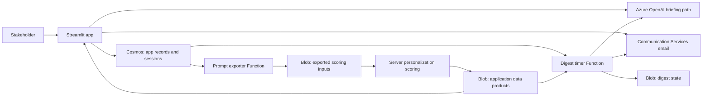

# Web application and Function source map

Updated November 3, 2026 after read-only inspection of the owner's local application checkout. Its HEAD matches the commit in the supplied successful Azure deployment log. No application modules were imported or run. The live site and deployed Function settings were not queried.

## Application structure

The UI is a Streamlit Python application. `app.py` configures navigation, coordinates sign-in/session restoration, and registers pages under `views/`. It is more than a display layer: application modules implement identity/session logic, persistence, collaboration, data loading and AI features.

| Responsibility | Source |
|---|---|
| Main application/navigation | `app.py`, `home.py`, `views/` |
| Sign-in and sessions | `user_auth.py`, `auth_utils.py` |
| Profile-related records, saved bills/searches, notes and sharing | `user_profile.py`, plus callers in the view code |
| Team lifecycle and membership | `team_service.py` |
| Transactional/sign-in and digest email | `email_service.py` |
| Data-product locations | `data_catalog.py` in each independently deployed component; values must stay restricted |
| Predictions and investigative results | `predictions_loader.py`, `investigation_loader.py` |
| Personalized results | `impact_loader.py` |
| AI briefings | `ai_briefing.py` |
| Exporter Function | `digest_function/prompt_exporter/__init__.py`, adjacent `function.json` |
| Digest Function | `digest_function/digest_timer/__init__.py`, adjacent `function.json` |
| Function host/dependencies | `digest_function/host.json`, `digest_function/requirements.txt` |

The checkout also contains a folder labelled for future server migration. Its presence does not establish deployment; do not substitute that copy for the separately captured running server project.

## Cosmos and authentication

`user_auth.py:87-115` creates a Cosmos client from environment settings and retrieves a database/container handle. The code references logical containers for user records, sign-in tokens, sessions and saved items. `team_service.py:58-71` additionally attempts to create or obtain a teams container with partition path `/pk`.

`app.py` calls magic-link verification and session restoration; `email_service.py` uses Azure Communication Services for email. These are implemented source paths, not a claim that every production authorization/TTL/identity setting has been validated. The actual partition keys, TTLs, permissions, user isolation and sign-in fallback behavior must be checked against the deployment.

## Blob-backed application reads

`impact_loader.py:23-39` reads the full configured impact-results Parquet into a server-side Streamlit cache with a 1,800-second TTL, then filters rows by the requested user ID. This code-level filter is not by itself proof of end-to-end access isolation: the caller's authenticated identity, cache boundaries and backing artifact permissions must also be verified. Other loaders and the view code must be checked against their configured data products.

`data_catalog.py` contains deployment-specific data locations. Document their roles through aliases in public; keep exact locations and any signed URLs in approved restricted storage. The app and Function folders have separate catalog/helper copies, so edits to one file do not necessarily update every consumer.

## Cosmos export and email digest Functions

The exporter source queries saved items of the prompt/profile types and writes scoring inputs to the curated Blob tier. Its timer binding reads `%PROMPT_EXPORT_CRON%`. The digest timer reads `%DIGEST_CRON%`; it loads user/saved-item data and legislative results, generates digest content through an Azure OpenAI code path, sends email through `email_service`, and keeps digest state in Blob Storage.

Both Function bindings specify `runOnStartup: false` and `useMonitor: true`. The schedule values, timezone, deployed Function app identities, source versions and actual enablement remain unverified. A successful web-app deployment does not prove that either Function was deployed or invoked.

Arrows represent inspected code dependencies, not successful live calls or a validated network/security diagram. Cosmos documents, exported inputs, digest state and personalized results require their own access/retention treatment.

## Deployment evidence

The supplied log shows a local Git push to the `azure` remote's `master` branch, followed by an Oryx Python build and successful Azure deployment. The observed build resolved Python 3.11.18; the application requirements include Streamlit. Record the exact checkout, commit and resource addresses in the restricted register. Treat the runtime from that build as observed release evidence, not a guarantee of the current portal runtime or startup command.

Do not repeat `git push azure master` simply to verify this map: that command deploys/recycles the live application. Build success is separate from checking site health, real data loads, sign-in, profile access, Function execution and scheduled digest delivery.

## Configuration names to inventory (never values)

| Consumer | Setting names found in source |
|---|---|
| Cosmos access | `COSMOS_ENDPOINT`, `COSMOS_KEY`, `COSMOS_DATABASE` |
| Sign-in/session behavior | `MAGIC_LINK_BASE_URL`, `MAGIC_LINK_SECRET`, `SESSION_TTL_DAYS`, `APP_PASSWORD` |
| Email | `ACS_CONNECTION_STRING`, `ACS_SENDER_ADDRESS` |
| App AI and digest AI | `AZURE_OPENAI_ENDPOINT`, `AZURE_OPENAI_KEY`, `AZURE_OPENAI_DEPLOYMENT`, `AZURE_OPENAI_API_VERSION` |
| Function Blob access | `LEGSTORAGE_CONNECTION_STRING`, `GOLD_CONTAINER` |
| Function timers | `PROMPT_EXPORT_CRON`, `DIGEST_CRON` |
| Digest operation | `APP_BASE_URL`, `IMPACT_RESULTS_PATH`, `DIGEST_STATE_PREFIX`, `DIGEST_DRY_RUN`, `DIGEST_STATE_FREEZE`, `DIGEST_DIAG`, `DIGEST_TEST_RECIPIENT` |

This list was extracted statically; some settings are optional, have defaults or control diagnostic/test behavior. Verify each consumer and deployment independently rather than treating all names as required everywhere.

## Azure metadata verified after source inspection

The owner supplied read-only Azure CLI output confirming a Linux Python 3.11 web runtime with a Streamlit startup command, both named Functions deployed, and a running Function app assigned to a Linux dedicated App Service plan. The container metadata confirms distinct user, session, saved-item, team, diagnostic and results stores. Exact resource identities, partition keys, TTL values, operational flags and backup settings are maintained in the restricted register.

The observed settings establish deployed configuration, not completed execution or tested recovery. Function invocation history, effective timer firing, authorization isolation and a recovery exercise remain unverified. A Cosmos results container also exists while inspected app code loads personalized results from Blob: identify its actual consumer before describing it as part of the active read/write path.

## Function deployment method confirmed

The owner supplied an expanded successful Function deployment log identifying the Azure CLI Functions deployer, ZIP deployment, extracted package input and a remote Oryx build. This confirms a separate Function ZIP-release path, distinct from the web app's local Git push. CI/CD was reported as not configured in the portal. The exact original publishing command and the source revision/package checksum are not yet recorded. A deployment UUID must not be treated as a source Git commit. No redeployment was performed during this inventory.

